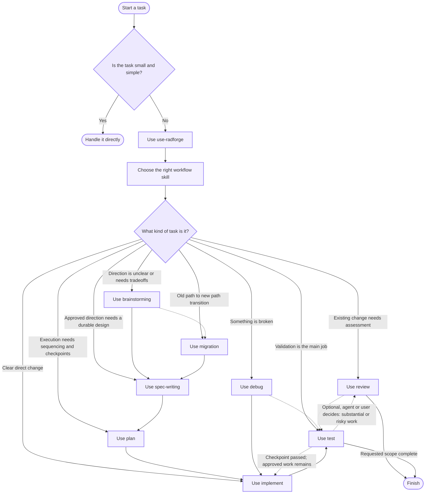

# Radforge

Radforge is a workflow skills framework for coding agents with clear routing, durable artifacts, and multi-provider installation support.

It packages a pragmatic workflow and skill library so supported agents can follow a consistent way of working.

## Quickstart

Install every Radforge skill for Claude Code with one command (requires Node.js 22.20 or later):

```sh
npx skills add tangthiendat/radforge -g --skill '*' -a claude-code -y
```

## Supported Providers

Radforge is plain `SKILL.md` folders, so it works with any agent that supports the [Agent Skills](https://agentskills.io) format, whatever model that agent runs.

The skills CLI installs to about 75 agents, including Claude Code, Codex, Cursor, GitHub Copilot, OpenCode, Gemini CLI, Windsurf, Roo Code, Kiro, Goose, Amp, Junie, and Qwen Code. See the [full agent list](https://github.com/vercel-labs/skills/blob/main/docs/agents.md).

## Install With The Skills CLI

The [skills CLI](https://github.com/vercel-labs/skills) installs, updates, and removes Radforge in one command each. These commands were last verified with skills CLI 1.9.0; other versions may behave differently.

Pass one `-a` per agent you use:

```sh
npx skills add tangthiendat/radforge -g --skill '*' -a claude-code -a codex -a cursor -a github-copilot -a opencode -y
```

| Agent          | `-a` value       |
| -------------- | ---------------- |
| Claude Code    | `claude-code`    |
| Codex          | `codex`          |
| Cursor         | `cursor`         |
| GitHub Copilot | `github-copilot` |
| OpenCode       | `opencode`       |

For any other agent, use its `--agent` id from the [CLI agent list](https://github.com/vercel-labs/skills/blob/main/docs/agents.md), for example `-a gemini-cli -a windsurf`. Without `-a`, the CLI uses the agents it detects on your machine, but with `-y` it installs to every supported agent when it detects none. Naming your agents with `-a` avoids that.

Keep these flags:

- `-g` installs for your user. Without it, skills go into the current project.
- `--skill '*'` installs every Radforge skill. The workflow skills share files inside `use-radforge`, so do not install only some of them.
- Name agents with `-a`. Do not use `--all`: it installs to every agent the CLI supports, not only yours.

Where the files go:

- Codex, Cursor, GitHub Copilot, OpenCode, and other agents that read the shared folder use `~/.agents/skills/`
- Claude Code uses `~/.claude/skills/`: a real copy when installed alone, or a symlink to the shared copy when installed together with those agents

Update or remove:

```sh
npx skills update -g -y
npx skills remove -g -y brainstorming debug implement migration plan review spec-writing test use-radforge
```

The CLI sends anonymous usage data. Set `DISABLE_TELEMETRY=1` to turn it off.

Then [verify the install](#verify-the-install).

Used the old install scripts? See [Upgrading From The Install Scripts](#upgrading-from-the-install-scripts).

## Verify The Install

After installing, open your coding tool and try this prompt:

```text
Tell me about Radforge.
```

If the installed skills are available, the agent should recognize Radforge and explain the workflow or available skills.

If your provider does not surface the skills automatically, try this instead:

```text
Use use-radforge and tell me which workflow skills are available.
```

## Upgrading From The Install Scripts

Earlier releases installed with `install.sh` and `install.ps1`. Those scripts are gone. The uninstall scripts remain so you can remove an old install.

1. Run one of the uninstall commands below.
2. Install again with the [skills CLI](#install-with-the-skills-cli).

Do not keep both: they write to different folders, so an agent could load each skill twice. These commands only remove script installs. To remove a CLI install, use `npx skills remove`.

### Uninstall all installed providers

### Windows PowerShell

```powershell
irm "https://raw.githubusercontent.com/tangthiendat/radforge/main/scripts/uninstall.ps1" | iex
```

### macOS Or Linux

```sh
curl -fsSL https://raw.githubusercontent.com/tangthiendat/radforge/main/scripts/uninstall.sh | bash
```

### Uninstall specific providers

Use the same provider values as install:

- `claude-code`
- `codex`
- `cursor`
- `github-copilot`
- `opencode`

### Windows PowerShell

```powershell
& ([scriptblock]::Create((irm "https://raw.githubusercontent.com/tangthiendat/radforge/main/scripts/uninstall.ps1"))) -Provider codex,claude-code
```

### macOS Or Linux

```sh
curl -fsSL https://raw.githubusercontent.com/tangthiendat/radforge/main/scripts/uninstall.sh | bash -s -- --provider codex,opencode
```

## How It Works

Radforge installs a shared skill library into the user-level skills directory for each provider you select.

After install, the usual flow is:

1. Install Radforge for one or more supported providers.
2. Start a task in your coding tool.
3. If the provider exposes installed skills, the agent can discover `use-radforge`.
4. If it does not route automatically, ask the agent to use `use-radforge` first for non-trivial work.
5. `use-radforge` picks one primary workflow skill and hands off immediately.

This release uses bootstrap routing through `use-radforge`.

Small, clear, low-risk tasks can still be handled directly without using the full workflow.

The diagram below is a high-level routing sketch. Actual handoffs can skip, stop, or route differently based on approval state, validation needs, or repository-local workflow rules. Dashed arrows show common secondary handoffs rather than the default primary path.

For standalone diagram docs, see [docs/radforge-high-level-orchestration.md](docs/radforge-high-level-orchestration.md) and [docs/radforge-full-orchestration.md](docs/radforge-full-orchestration.md).



For non-trivial work, the routing guide is:

- use `review` when you need to assess existing changes for bugs, regressions, missing validation, or rollout risk
- start in `brainstorming` when the direction, scope, or approval is still unclear
- use `spec-writing` when the direction is mostly decided and you still need a durable design in the spec folder (`docs/radforge/specs/` by default)
- use `migration` when moving from an old path to a new one and compatibility, cutover, or rollback is the hard part
- move to `plan` when the direction is already clear and the remaining job is execution structure
- stay in `implement` when one bounded checkpoint plus one local smoke-style check is enough to support the claim
- hand off to `test` when you need broader proof or more regression confidence
- after substantial or risky work passes validation, `review` is an optional last step: the agent may run or offer it, and you can ask for it or skip it

Preserve the original goal, acceptance criteria, plan/task position, remaining work, user constraints, and existing authorization across handoffs. A passing checkpoint returns from `test` to `implement` when approved tasks remain. Finish only when the requested scope is satisfied; explicit validation-only or checkpoint-only requests stop at their requested boundary with remaining work reported.

Repository-local instructions still take priority over user-level Radforge defaults.

## Example Session

An illustrative run, not a recorded transcript. You ask your agent: "Add rate limiting to the login endpoint."

1. `use-radforge` loads the shared contract and routes the task. It is clear but touches several files and carries risk, so it picks `plan`:

   ```text
   Decision: use Radforge (non-trivial, several files)
   Routing Basis: default precedence, clear but risky execution
   Selected Skill: plan
   Override: none
   Next Handoff: plan
   ```

2. `plan` writes ordered tasks to `docs/radforge/plans/` (limiter middleware, configuration, tests) and asks you to approve the sequencing and risk. You approve.
3. `implement` works through the tasks one checkpoint at a time, running one quick check each. It does not ask for approval again, because your approval already covers the plan.
4. `test` runs the broader checks (the unit tests and a repeated-login check) and records the commands, expected results, and what it observed.
5. Because the work was risky and is now fully validated, the agent may run `review` or offer it. You can say "skip" and the work ends there.
6. The agent closes out with what changed, what was validated, what was skipped, any remaining risk, and whether the work is complete.

A small task, such as fixing a typo, skips all of this and is handled directly.

## What's Inside

### Workflow Skills

- `migration`: manages old-path to new-path transitions with compatibility, cutover, rollback, and rollout thinking
- `review`: inspects existing changes for bugs, regressions, missing validation, and rollout risk
- `brainstorming`: clarifies direction, scope, and approval before execution
- `spec-writing`: turns approved or nearly approved direction into a durable design artifact
- `plan`: organizes approved or already-clear work into resumable execution structure
- `implement`: executes clear changes inside a bounded checkpoint
- `test`: validates changes when broader proof or regression confidence is needed
- `debug`: reproduces and isolates failures before fixing them

### Bootstrap Skill

- `use-radforge`: the bootstrap router for non-trivial work

### Workflow Closeout

- once Radforge workflow is in use, non-trivial work should report what changed, what was validated, what was skipped, and any remaining risk

## What Gets Installed

The skills CLI copies every skill from `skills/` into the shared `~/.agents/skills/` folder for agents that read it, and into an agent's own folder for agents that do not, such as Claude Code. When both kinds are installed together, the agent's own folder links to the shared copy.

- `use-radforge` is installed alongside the core workflow skills
- the CLI records installs in its own lock file, which `npx skills update` and `npx skills remove` use
- it does not replace repository-local instructions

## Updating Radforge

```sh
npx skills update -g -y
```

## Notes

- the uninstall scripts use the stored provider state files in `~/.radforge/providers/` to remove only Radforge-managed assets from old script installs
- specs and plans go to a path you name, otherwise to your repository's existing spec or plan folder, otherwise to `docs/radforge/specs/` or `docs/radforge/plans/`
- actual skill auto-invocation still depends on the provider surfacing installed skills to the model for that session
